<div align="center">


# FFmpeg Modular Batch GUI (Linux Native)

**Enterprise-grade, multi-threaded audio & video transcoding workstation for Linux.**  
*Native PySide6 / Qt6 rewrite achieving 100% feature parity with legacy Windows FFmpeg Batch AV Converter.*

[](#)
[](#)
[](#)
[](#)
[](LICENSE)

[Key Features](#key-features) •
[Operational Architecture](#operational-architecture) •
[Integrated Tool Suite](#integrated-tool-suite) •
[Installation](#installation--setup) •
[Keyboard Shortcuts](#keyboard-shortcuts) •
[License](#license)

</div>

---

## Executive Overview

**FFmpeg Modular Batch GUI** is a high-throughput, concurrent media processing suite engineered specifically for Linux desktop environments. Purged of all legacy Windows API calls (`kernel32.dll`, Win32 registry, WinForms geometry, and `.exe` path assumptions), this software leverages modern Unix design paradigms:

- **Strictly Decoupled UI Model:** 100% of the visual presentation layer is maintained as clean, standard Qt `.ui` XML documents editable visually in Qt Designer (`designer-qt6`). Zero hardcoded layout geometry in Python.
- **Pure Linux Ecosystem:** Direct integration with system-level Linux utilities: `ffmpeg`, `ffprobe`, `yt-dlp`, `xdg-open`, `notify-send`, and `/sys/class/power_supply`.
- **High-Performance Concurrency:** Multi-threaded queue engine managed by `QThreadPool` and `QRunnable`, providing real-time per-file progress metrics, ETA calculations, non-blocking UI responsiveness, and granular CPU affinity/priority control.

---

## Key Features

### 1. Four Dedicated Operational Modules

| Module | Core Functionality | Engine Backing |
| :--- | :--- | :--- |
| **Batch Processing** | High-volume transcoding queue with 2-pass support, hardware acceleration (NVENC, VAAPI, QSV), audio normalization, watermarking, and dynamic variable tokens. | `core.engine.FFmpegTask` |
| **Stream Multiplexing** | Container-level multi-track assembly for video, multi-language audio tracks, and soft subtitles with disposition tags (`default`, `forced`). | `core.mux_engine.MuxJobTask` |
| **Batch Subtitles** | Automated subtitle hardcode burn-in (`-vf subtitles=...`) or soft-embed muxing with customizable fonts, font sizes, and ASS styles. | `core.subs_engine.SubtitleTask` |
| **URLs & Streaming** | Remote media ingestion, playlist processing, and direct stream remuxing via yt-dlp with automated stream quality selection. | `core.url_engine.UrlStreamTask` |

---

### 2. Complete Legacy Parity Matrix

Every utility from the original .NET WinForms FFBatch application has been faithfully ported to Linux native workflows:

```mermaid
graph TD
    A[Queue Management] --> A1[Advanced Attribute Filtering]
    A --> A2[Custom Column Configurator]
    A --> A3[Frame Preview & Thumbnail Inspector]
    
    B[Automation & Power] --> B1[Delayed Start Scheduler]
    B --> B2[Linux Battery & AC Power Watchdog]
    B --> B3[Per-File & Completion Shell Hooks]

    C[Stream & Path Control] --> C1[Interactive Stream Routing Matrix]
    C --> C2[Batch Intro / Outro Stitching]
    C --> C3[Hierarchy & Folder Structure Replicator]

    D[Presets & Guidance] --> D1[Community Online Presets Browser]
    D --> D2[Unified Native Task Wizard]
```



---

## Integrated Tool Suite

Accessible via top-level menus, toolbar buttons, and contextual menus:

### Queue & Analysis
- **Advanced Queue Filtering (`Ctrl + F`):** Query items by file size, codec, total bitrate, duration thresholds, or queue status (`pending`, `encoding`, `completed`, `failed`). Keep or eliminate matching records in batch.
- **Configurable Table Columns:** Selectively toggle and order table columns (`#`, `File Name`, `Duration`, `Video Codec`, `Audio Codec`, `Size`, `Est. Size`, `Progress`, `Status`) with persistent configuration in `config.json`.
- **Frame Preview & Thumbnail Inspector:** Instant high-resolution frame extraction with smooth aspect-ratio scaling, clipboard copy, and PNG/JPEG export.
- **MediaStream Inspector (`Ctrl + I`):** Comprehensive stream analyzer extracting deep audio, video, subtitle metadata and raw JSON streams via `ffprobe`.

### Advanced Processing Tools
- **Guided Task Wizard:** 3-step native task builder (replaces legacy AeroWizard) for rapid configuration of H.264, HEVC, Audio Extraction, WebM VP9, and Silence Removal.
- **Batch Intro & Outro Stitcher:** Automatically prepend header clips and append trailer clips across the entire batch queue with fast stream-copy and auto-reencode fallback.
- **Interactive Stream Routing Matrix:** Track-by-track mapping table to manage disposition flags (`default`, `forced`), ISO-639-2 language tags, and custom audio channel layouts.
- **Two-Pass Target Size Calculator (`Ctrl + Shift + Z`):** Computes exact video bitrates required to meet strict target file sizes (e.g., Discord 25MB, DVD 4.7GB, Email limits).
- **Audio Waveform Visualizer:** Visualizes audio waveform topology and channel balance using FFmpeg's `showwavespic` filter.
- **Crop & Black Bars Detector:** Automated detection via FFmpeg `cropdetect` filter with preview extraction and aspect ratio presets.
- **Watermark & Logo Overlay:** Dynamic overlay engine with 9-point grid alignment, padding offsets, and opacity tuning.
- **Silence Detector & Remover:** Detects and trims silence intervals across audio files utilizing `silencedetect` and `silenceremove`.
- **Sequential Batch Renamer:** Batch renames queued items using dynamic pattern substitution (`{num}`, `{name}`, `{date}`, `{res}`).
- **Desktop Screen Recording:** Integrated Linux screen recording utilizing FFmpeg's `x11grab` device.
- **Online Community Presets Browser:** Search, preview, and download community presets with one-click injection into local configs.

### System & Power Management
- **Linux Battery & AC Watchdog:** Actively polls `/sys/class/power_supply` every 5 seconds. Automatically pauses heavy transcode jobs when running on battery (or below a configurable threshold) and resumes upon AC reconnect.
- **Delayed Execution Scheduler:** Schedule queue processing by countdown timer or specific wall-clock target time (e.g. overnight execution).
- **Post-Processing Shell Hooks:** Trigger automated scripts on every successfully encoded file (`{input}`, `{output}`, `{status}` tokens) or upon full queue completion.

---

## Installation & Setup

### Prerequisites

For Debian / Ubuntu-based Linux distributions:

```bash
sudo apt update
# Ubuntu splits PySide6 into modular component packages
sudo apt install -y python3 python3-pip python3-pyside6.qtwidgets python3-pyside6.qtcore python3-pyside6.qtgui python3-pyside6.qtuitools ffmpeg yt-dlp qt6-tools-dev-tools libpulse0
# Or install PySide6 via pip:
# pip install pyside6
```

For Arch Linux / Manjaro:

```bash
sudo pacman -S python python-pyside6 ffmpeg yt-dlp qt6-tools
```

For Fedora / RHEL:

```bash
sudo dnf install -y python3 python3-pyside6 ffmpeg yt-dlp qt6-tools-devel
```

### Repository Setup

```bash
# Clone the repository
git clone https://github.com/arean/FFmpeg-Modular-Batch-GUI.git
cd FFmpeg-Modular-Batch-GUI

# Install Python requirements (if virtual environment is preferred)
pip install -r requirements.txt
```

---

## Launching the Application

### Via CLI

```bash
python3 main.py
```

### Desktop Menu Integration

To install the desktop launcher shortcut in your Linux desktop environment (GNOME, KDE Plasma, XFCE):

```bash
mkdir -p ~/.local/share/applications
cat << 'EOF' > ~/.local/share/applications/ffmpeg-modular-batch.desktop
[Desktop Entry]
Type=Application
Name=FFmpeg Modular Batch GUI
GenericName=Audio & Video Batch Converter
Comment=Native Linux Multi-Threaded FFmpeg Converter
Exec=python3 /git/FFmpeg-Modular-Batch-GUI/main.py
Icon=/git/FFmpeg-Modular-Batch-GUI/assets/app_icon.png
Terminal=false
Categories=AudioVideo;AudioVideoEditing;Audio;Video;
Keywords=ffmpeg;transcode;batch;converter;video;audio;
EOF
```

---

## Dynamic Variable Tokens

The application supports robust string interpolation for output names and parameters:

| Variable | Description | Resolved Example |
| :--- | :--- | :--- |
| `%~n` / `{name}` | Source file basename without extension | `input_video` |
| `%~x` / `{ext}` | Source file extension | `mp4` |
| `<res>` / `{res}` | Video stream resolution | `1920x1080` |
| `<vcodec>` | Primary video codec name | `h264` |
| `<acodec>` | Primary audio codec name | `aac` |
| `<source_dir>` | Absolute directory containing source file | `/home/user/Videos` |
| `{input}` | Full source input path | `/home/user/Videos/clip.mkv` |
| `{output}` | Full target destination path | `/home/user/Videos/clip_converted.mp4` |

---

## Keyboard Shortcuts

| Shortcut | Scope | Action |
| :---: | :--- | :--- |
| <kbd>Ctrl</kbd> + <kbd>O</kbd> | Global | Open / Add Files to Queue |
| <kbd>Ctrl</kbd> + <kbd>R</kbd> | Global | Start Batch Queue Processing |
| <kbd>Ctrl</kbd> + <kbd>F</kbd> | Queue | Open Advanced Queue Filtering Dialog |
| <kbd>Ctrl</kbd> + <kbd>I</kbd> | Queue | Inspect Selected Media Stream (MediaInfo) |
| <kbd>Ctrl</kbd> + <kbd>Shift</kbd> + <kbd>Z</kbd> | Tools | Two-Pass Target Size Calculator |
| <kbd>Ctrl</kbd> + <kbd>L</kbd> | Tools | Open Full FFmpeg Execution Log Viewer |
| <kbd>Ctrl</kbd> + <kbd>,</kbd> | Application | Open Application Preferences & Binary Paths |
| <kbd>F1</kbd> | Global | Open Internal Readme & Help Viewer |
| <kbd>Delete</kbd> | Queue | Remove Selected Queue Items |
| <kbd>Ctrl</kbd> + <kbd>Q</kbd> | Application | Quit Application |

---

## Codebase Architecture

```
FFmpeg-Modular-Batch-GUI/
├── assets/                  # Icons, application styling, sample assets, sound chimes
│   ├── app_icon.png
│   ├── complete.wav
│   └── themes/              # Light and Dark Qt Style Sheets (QSS)
├── core/                    # Headless business logic, transcode runners, metadata probes
│   ├── concat_engine.py     # Stream copy demuxer & concat filter engine
│   ├── config_manager.py    # Binary path detector & preferences persistence
│   ├── crop_engine.py       # Black bars cropdetect parser
│   ├── engine.py            # QRunnable FFmpeg transcode worker & signal relays
│   ├── estimations.py       # File size & bitrate mathematical calculators
│   ├── mux_engine.py        # Multi-track container multiplexing engine
│   ├── power_monitor.py     # Linux sysfs power supply & battery watchdog
│   ├── presets.py           # Local preset loading and serializing
│   ├── probe.py             # ffprobe JSON extractor & stream parser
│   ├── subs_engine.py       # Subtitle burn-in & soft muxing task
│   ├── theme_manager.py     # Dynamic Material/Standard QSS switching
│   ├── tokens.py            # Template token interpolator
│   └── url_engine.py        # yt-dlp online media extractor
├── ui/                      # 100% Decoupled Qt Designer (.ui) XML Layouts
│   ├── main_window.ui       # Main 4-tab workbench interface
│   ├── queue_filter_dialog.ui
│   ├── custom_columns_dialog.ui
│   ├── frame_preview_dialog.ui
│   ├── task_wizard_dialog.ui
│   ├── online_presets_dialog.ui
│   ├── batch_concat_dialog.ui
│   ├── stream_matrix_dialog.ui
│   ├── output_path_dialog.ui
│   ├── delay_timer_dialog.ui
│   ├── battery_power_dialog.ui
│   └── post_process_dialog.ui
├── main.py                  # PySide6 application orchestrator & signal controller
├── presets.json             # Default encoding presets database
└── README.md                # Platinum-grade documentation
```

---

## Author & Maintainer

- **Author:** Arean
- **Email:** [arean@synorastudio.in](mailto:arean@synorastudio.in)
- **Organization:** Synora Studio

---

## License

This software is distributed under the terms of the **MIT License**.  
See the [LICENSE](LICENSE) file for complete details.

---

<div align="center">
<sub>Crafted with precision for Linux audio/video production engineers.</sub>
</div>
