<div align="center">


# FFmpeg Modular Batch GUI (Linux Native)

**Platinum-Grade, Multi-Threaded Audio & Video Transcoding Workstation for Linux.**  
*Native PySide6 / Qt6 rewrite achieving 100% feature parity with legacy Windows FFmpeg Batch AV Converter.*

[](#)
[](#)
[](#)
[](#)
[](LICENSE)

[Key Features](#key-features) •
[Operational Architecture](#operational-architecture) •
[Integrated Tool Suite](#integrated-tool-suite) •
[Installation](#installation--setup) •
[Keyboard Shortcuts](#keyboard-shortcuts) •
[Packaging](#distribution--packaging) •
[Author & License](#author--maintainer)

</div>

---

## Executive Overview

**FFmpeg Modular Batch GUI** is a high-throughput, concurrent media processing workstation engineered specifically for Linux desktop environments. Purged of all legacy Windows API dependencies (`kernel32.dll`, Win32 registry, WinForms geometry, and `.exe` path assumptions), this software leverages modern Unix design paradigms:

- **Strictly Decoupled UI Model:** 100% of the visual presentation layer is maintained as clean, standard Qt `.ui` XML documents editable visually in Qt Designer (`designer-qt6`). Zero hardcoded layout geometry in Python.
- **Pure Linux Ecosystem:** Direct integration with system-level Linux utilities: `ffmpeg`, `ffprobe`, `yt-dlp`, `xdg-open`, `notify-send`, D-Bus power inhibitors, and `/sys/class/power_supply`.
- **True Multi-Core & Hardware Parallelism:** Non-blocking multi-threaded queue engine managed by `QThreadPool` and `QRunnable`, driving isolated Linux processes across all CPU cores and GPU encoding sessions (NVENC / VAAPI / QSV).
- **SQLite Persistence & Crash Recovery:** Integrated database layer (`core/database.py`) providing transactional queue persistence, historical job audit logs, failure diagnostics, and portable preset bundle export/import.

---

## Key Features

### 1. Four Dedicated Operational Modules

| Module | Core Functionality | Engine Backing |
| :--- | :--- | :--- |
| **Batch Processing** | High-volume transcoding queue with 2-pass support, hardware acceleration (NVENC, VAAPI, QSV), audio normalization (EBU R128), watermarking, and dynamic variable tokens. | `core.engine.FFmpegTask` |
| **Stream Multiplexing** | Container-level multi-track assembly for video, multi-language audio tracks, and soft subtitles with disposition tags (`default`, `forced`). | `core.mux_engine.MuxJobTask` |
| **Batch Subtitles** | Automated subtitle hardcode burn-in (`-vf subtitles=...`) or soft-embed muxing with customizable fonts, font sizes, and ASS styles. | `core.subs_engine.SubtitleTask` |
| **URLs & Streaming** | Remote media ingestion, playlist processing, and direct stream remuxing via `yt-dlp` with automated stream quality profile selection. | `core.url_engine.UrlStreamTask` |

---

### 2. Complete Legacy Parity & Advanced Capabilities

Every utility from the original .NET WinForms FFBatch application has been faithfully ported to Linux native workflows, alongside enterprise additions:

```mermaid
graph TD
    A[Queue Management] --> A1[Advanced Attribute Filtering]
    A --> A2[Custom Column Configurator]
    A --> A3[Interactive Player & Frame Preview]
    A --> A4[Native Drag-and-Drop Reordering]

    B[Automation & Power] --> B1[Delayed Start Scheduler]
    B --> B2[Linux Battery Watchdog]
    B --> B3[D-Bus OS Sleep Inhibitor]
    B --> B4[Hot Folder inotify Daemon]

    C[Media Processing] --> C1[Interactive Stream Routing Matrix]
    C --> C2[Visual Rubber-Band Crop]
    C --> C3[EBU R128 Loudness Normalizer]
    C --> C4[HDR10 to SDR BT.709 Tone-Mapping]

    D[Quality & Inspection] --> D1[VMAF / SSIM / PSNR Quality Inspector]
    D --> D2[Automated GPU Encoder Probing]
    D --> D3[Pre-Flight Disk Space Checker]
    D --> D4[Process Hang Watchdog & Auto-Retry]
```



---

## Integrated Tool Suite

Accessible via top-level menus, toolbar buttons, and contextual menus:

### Queue & Analysis
- **Advanced Queue Filtering (`Ctrl + F`):** Query items by file size, codec, total bitrate, duration thresholds, or queue status (`pending`, `encoding`, `completed`, `failed`). Keep or eliminate matching records in batch.
- **Configurable Table Columns:** Selectively toggle and order table columns (`#`, `File Name`, `Duration`, `Video Codec`, `Audio Codec`, `Size`, `Est. Size`, `Progress`, `Status`) with persistent configuration in SQLite and `config.json`.
- **Interactive Video Player Preview (`Ctrl + P`):** Full built-in video player using PySide6's Qt Multimedia stack with instant seeking, volume control, variable playback speed (0.25× to 2.0×), snapshot export, and queue navigation.
- **Frame Preview & Thumbnail Inspector:** Instant high-resolution frame extraction with smooth aspect-ratio scaling, clipboard copy, and PNG/JPEG export.
- **MediaStream Inspector (`Ctrl + I`):** Comprehensive stream analyzer extracting deep audio, video, subtitle metadata and raw JSON streams via `ffprobe`.
- **Desktop Drag-and-Drop:** Drag files or entire folders directly from Linux file managers (Nautilus, Dolphin, Thunar) into the queue table with automatic exclusion filtering.
- **Interactive Header Sorting:** Click any column header to toggle ascending/descending order with automatic list and SQLite persistence synchronization.

### Advanced Media Processing
- **EBU R128 / ITU-R BS.1770 Audio Loudness Normalizer:** Built-in broadcast & web streaming targets (YouTube -14 LUFS, EBU R128 -23 LUFS, ATSC A/85 -24 LUFS, Podcast -16 LUFS) with Pass 1 integrated loudness measurement.
- **Interactive Visual Rubber-Band Crop:** Click-and-drag `QRubberBand` marquee over source video frames to visually draw exact crop boundaries and generate `-vf crop=w:h:x:y` filters.
- **HDR10 to SDR BT.709 Tone-Mapping:** 1-click Mobius and Hable color space conversion filter graphs preventing washed-out colors when down-converting 4K 10-bit HDR content to standard 8-bit SDR.
- **VMAF / SSIM / PSNR Video Quality Scorer:** Objective dual-input video evaluation comparing encoded files against source originals to quantitatively grade visual compression fidelity.
- **Automated GPU Hardware Encoder Prober:** Probes available NVENC, VAAPI, and Intel QSV hardware transcode pipelines in milliseconds via FFmpeg null-sink tests with 1-click argument injection.
- **GPU OpenCL / Vulkan Filter Acceleration:** One-click injection of hardware filter acceleration flags to offload video scaling and color transforms to the GPU even when using CPU encoders.
- **Batch Chapter Generator:** Auto-generates timestamped chapters at 5-minute intervals or custom marks with FFMETADATA file export and video container injection.
- **Guided Task Wizard:** 3-step native task builder (replaces legacy AeroWizard) for rapid configuration of H.264, HEVC, Audio Extraction, WebM VP9, and Silence Removal.
- **Batch Intro & Outro Stitcher:** Automatically prepend header clips and append trailer clips across the entire batch queue with fast stream-copy and auto-reencode fallback.
- **Interactive Stream Routing Matrix:** Track-by-track mapping table to manage disposition flags (`default`, `forced`), ISO-639-2 language tags, and custom audio channel layouts.
- **Two-Pass Target Size Calculator (`Ctrl + Shift + Z`):** Computes exact video bitrates required to meet strict target file sizes (e.g., Discord 25MB, DVD 4.7GB, Email limits).
- **Audio Waveform Visualizer:** Visualizes audio waveform topology and channel balance using FFmpeg's `showwavespic` filter.
- **Watermark & Logo Overlay:** Dynamic overlay engine with 9-point grid alignment, padding offsets, and opacity tuning.
- **Silence Detector & Remover:** Detects and trims silence intervals across audio files utilizing `silencedetect` and `silenceremove`.
- **Sequential Batch Renamer:** Batch renames queued items using dynamic pattern substitution (`{num}`, `{name}`, `{date}`, `{res}`).
- **Desktop Screen Recording:** Native Linux screen recording supporting both modern **Wayland** (via PipeWire audio and KMS capture) and classic **X11** (`x11grab`).

### System, Safety & Automation
- **Pre-Flight Disk Space Checker:** Validates target drive free storage (`shutil.disk_usage`) against aggregate estimated output size prior to queue launch, warning the user before out-of-space crashes occur.
- **Subprocess Hang Watchdog & Smart Auto-Retry:** Automatically detects frozen or deadlocked FFmpeg subprocesses (60s idle timeout), and auto-retries failed GPU tasks with CPU software encoders (`libx264`).
- **Automated Hot Folder Watchdog Daemon:** Monitors input directories using Linux kernel `inotify` (`QFileSystemWatcher`), waiting for file writes to stabilize before auto-queueing and converting.
- **D-Bus OS Sleep & Blanking Inhibitor:** Multi-tier power inhibition communicating with `org.freedesktop.PowerManagement`, `org.gnome.SessionManager`, `org.freedesktop.ScreenSaver`, and `systemd-inhibit` to block system suspend and screen blanking during active encoding, featuring live status pill indicators.
- **Hardware Thermal Guard:** Real-time CPU package and GPU thermal surveillance (`/sys/class/thermal/`, `sensors`, `nvidia-smi`, `rocm-smi`) that automatically pauses the encoding queue if hardware exceeds safe temperature thresholds (e.g., 85°C) and resumes upon cooling.
- **Queue Script Exporter (`.sh`):** Export complete queue configurations to standalone, executable POSIX bash scripts with colorized progress reporting and optional multi-threaded parallel execution (`xargs`) for remote server farms.
- **Queue Portability (JSON / CSV):** Save and import batch queues with item parameters, statuses, and metadata for seamless project saving and cross-machine queue transfer.
- **FreeDesktop Desktop & File Manager Integration:** One-click registration of `.desktop` entry and MIME associations (`video/*`, `audio/*`) enabling right-click context menu enqueueing in Dolphin, Nautilus, and Thunar.
- **Linux Battery & AC Watchdog:** Actively polls `/sys/class/power_supply` every 5 seconds. Automatically pauses heavy transcode jobs when running on battery and resumes upon AC reconnect.
- **SQLite Audit Trail & Diagnostics:** Logs every job execution with execution time, parameter strings, and full stderr failure slices accessible via double-clicking failed items.
- **Delayed Execution Scheduler:** Schedule queue processing by countdown timer or specific wall-clock target time (e.g. overnight execution).
- **Post-Processing Shell Hooks:** Trigger automated scripts on every successfully encoded file (`{input}`, `{output}`, `{status}` tokens) or upon full queue completion.

---

## Installation & Setup

### Prerequisites

For Debian / Ubuntu-based Linux distributions:

```bash
sudo apt update
# Modular PySide6 and multimedia dependencies
sudo apt install -y python3 python3-pip python3-pyside6.qtwidgets python3-pyside6.qtcore \
                    python3-pyside6.qtgui python3-pyside6.qtmultimedia python3-pyside6.qtmultimediawidgets \
                    python3-pyside6.qtuitools ffmpeg yt-dlp qt6-tools-dev-tools libpulse0
```

For Arch Linux / Manjaro:

```bash
sudo pacman -S python python-pyside6 ffmpeg yt-dlp qt6-tools
```

For Fedora / RHEL:

```bash
sudo dnf install -y python3 python3-pyside6 ffmpeg yt-dlp qt6-tools-devel
```

### Repository Setup

```bash
# Clone the repository
git clone https://github.com/arean/FFmpeg-Modular-Batch-GUI.git
cd FFmpeg-Modular-Batch-GUI

# Install Python requirements (if virtual environment is preferred)
pip install -r requirements.txt
```

---

## Launching the Application

### Via CLI

```bash
python3 main.py
```

### Desktop Menu Integration

To install the desktop launcher shortcut in your Linux desktop environment (GNOME, KDE Plasma, XFCE):

```bash
mkdir -p ~/.local/share/applications
cat << 'EOF' > ~/.local/share/applications/ffmpeg-modular-batch.desktop
[Desktop Entry]
Type=Application
Name=FFmpeg Modular Batch GUI
GenericName=Audio & Video Batch Converter
Comment=Native Linux Multi-Threaded FFmpeg Converter
Exec=python3 /git/FFmpeg-Modular-Batch-GUI/main.py
Icon=/git/FFmpeg-Modular-Batch-GUI/assets/app_icon.png
Terminal=false
Categories=AudioVideo;AudioVideoEditing;Audio;Video;
Keywords=ffmpeg;transcode;batch;converter;video;audio;
EOF
```

---

## Distribution & Packaging

The repository includes ready-to-build distribution manifests:

- **Flatpak:** Built using `packaging/in.synorastudio.FFmpegBatchGUI.yaml` targeting the `org.kde.Platform` 6.6 runtime with Wayland, X11, D-Bus, and DRI hardware acceleration permissions.
- **AppImage:** Configured via `packaging/AppImageBuilder.yml` for self-contained, single-file distribution across any modern Linux distribution.

---

## Dynamic Variable Tokens

The application supports robust string interpolation for output names and parameters:

| Variable | Description | Resolved Example |
| :--- | :--- | :--- |
| `%~n` / `{name}` | Source file basename without extension | `input_video` |
| `%~x` / `{ext}` | Source file extension | `mp4` |
| `<res>` / `{res}` | Video stream resolution | `1920x1080` |
| `<vcodec>` | Primary video codec name | `h264` |
| `<acodec>` | Primary audio codec name | `aac` |
| `<source_dir>` | Absolute directory containing source file | `/home/user/Videos` |
| `{input}` | Full source input path | `/home/user/Videos/clip.mkv` |
| `{output}` | Full target destination path | `/home/user/Videos/clip_converted.mp4` |

---

## Keyboard Shortcuts

| Shortcut | Scope | Action |
| :---: | :--- | :--- |
| <kbd>Ctrl</kbd> + <kbd>O</kbd> | Global | Open / Add Files to Queue |
| <kbd>Ctrl</kbd> + <kbd>R</kbd> | Global | Start Batch Queue Processing |
| <kbd>Ctrl</kbd> + <kbd>P</kbd> | Global | Launch Interactive Video Player Preview |
| <kbd>Ctrl</kbd> + <kbd>F</kbd> | Queue | Open Advanced Queue Filtering Dialog |
| <kbd>Ctrl</kbd> + <kbd>I</kbd> | Queue | Inspect Selected Media Stream (MediaInfo) |
| <kbd>Ctrl</kbd> + <kbd>Shift</kbd> + <kbd>Z</kbd> | Tools | Two-Pass Target Size Calculator |
| <kbd>Ctrl</kbd> + <kbd>L</kbd> | Tools | Open Full FFmpeg Execution Log Viewer |
| <kbd>Ctrl</kbd> + <kbd>,</kbd> | Application | Open Application Preferences & Binary Paths |
| <kbd>F1</kbd> | Global | Open Internal Readme & Help Viewer |
| <kbd>Delete</kbd> | Queue | Remove Selected Queue Items |
| <kbd>Ctrl</kbd> + <kbd>Q</kbd> | Application | Quit Application |

---

## Codebase Architecture

```
FFmpeg-Modular-Batch-GUI/
├── assets/                  # Icons, sound chimes, vendor JS, badges
│   ├── app_icon.png
│   ├── complete.wav
│   ├── badges/              # Offline SVG badges for internal documentation viewer
│   ├── themes/              # Light and Dark Qt Style Sheets (QSS)
│   └── vendor/              # Local marked.min.js and mermaid.min.js
├── core/                    # Headless business logic, transcode runners, probes
│   ├── concat_engine.py     # Stream copy demuxer & concat filter engine
│   ├── config_manager.py    # Binary path detector & preferences persistence
│   ├── crop_engine.py       # Black bars cropdetect parser
│   ├── database.py          # SQLite persistence, crash-recovery & audit logs
│   ├── disk_preflight.py    # Free disk space & storage safety validator
│   ├── engine.py            # QRunnable FFmpeg worker, watchdogs & signals
│   ├── estimations.py       # File size & bitrate mathematical calculators
│   ├── gpu_probe.py         # Hardware GPU encoder probe (NVENC, VAAPI, QSV)
│   ├── hot_folder.py        # Automated inotify folder monitoring daemon
│   ├── loudnorm_engine.py   # EBU R128 & ITU-R BS.1770 audio normalization
│   ├── mux_engine.py        # Multi-track container multiplexing engine
│   ├── power_monitor.py     # Linux sysfs power supply & battery watchdog
│   ├── presets.py           # Relational presets manager & bundle export/import
│   ├── probe.py             # ffprobe JSON extractor & stream parser
│   ├── readme_viewer.py     # Offline documentation browser (QWebEngineView)
│   ├── sleep_inhibitor.py   # D-Bus org.freedesktop.ScreenSaver sleep blocker
│   ├── subs_engine.py       # Subtitle burn-in & soft muxing task
│   ├── theme_manager.py     # Dynamic Material/Standard QSS switching
│   ├── tokens.py            # Template token interpolator
│   ├── tonemap_engine.py    # HDR10 to SDR BT.709 color conversion filter graphs
│   ├── url_engine.py        # yt-dlp online media extractor & format profiles
│   └── vmaf_engine.py       # Objective video quality scorer (VMAF, SSIM, PSNR)
├── packaging/               # Distribution manifests
│   ├── AppImageBuilder.yml  # AppImage packaging specification
│   ├── ffmpeg-batch-gui.sh  # Standalone launcher wrapper
│   ├── in.synorastudio.FFmpegBatchGUI.desktop
│   └── in.synorastudio.FFmpegBatchGUI.yaml   # KDE/Qt6 Flatpak manifest
├── ui/                      # 100% Decoupled Qt Designer (.ui) XML Layouts (38 dialogs)
│   ├── main_window.ui       # Main 4-tab workbench interface
│   ├── video_player_dialog.ui
│   ├── vmaf_dialog.ui
│   ├── hot_folder_dialog.ui
│   ├── loudness_norm_dialog.ui
│   ├── settings_dialog.ui
│   └── ... (38 dialog XMLs)
├── main.py                  # PySide6 application orchestrator & signal controller
├── presets.json             # Default encoding presets database
├── ffbatch.db               # SQLite database (auto-generated)
└── README.md                # Platinum-grade documentation
```

---

## Author & Maintainer

- **Author:** Arean
- **Email:** [arean@synorastudio.in](mailto:arean@synorastudio.in)
- **Organization:** Synora Studio

---

## License

This software is distributed under the terms of the **MIT License**.  
See the [LICENSE](LICENSE) file for complete details.

---

<div align="center">
<sub>Crafted with precision for Linux audio/video production engineers.</sub>
</div>
